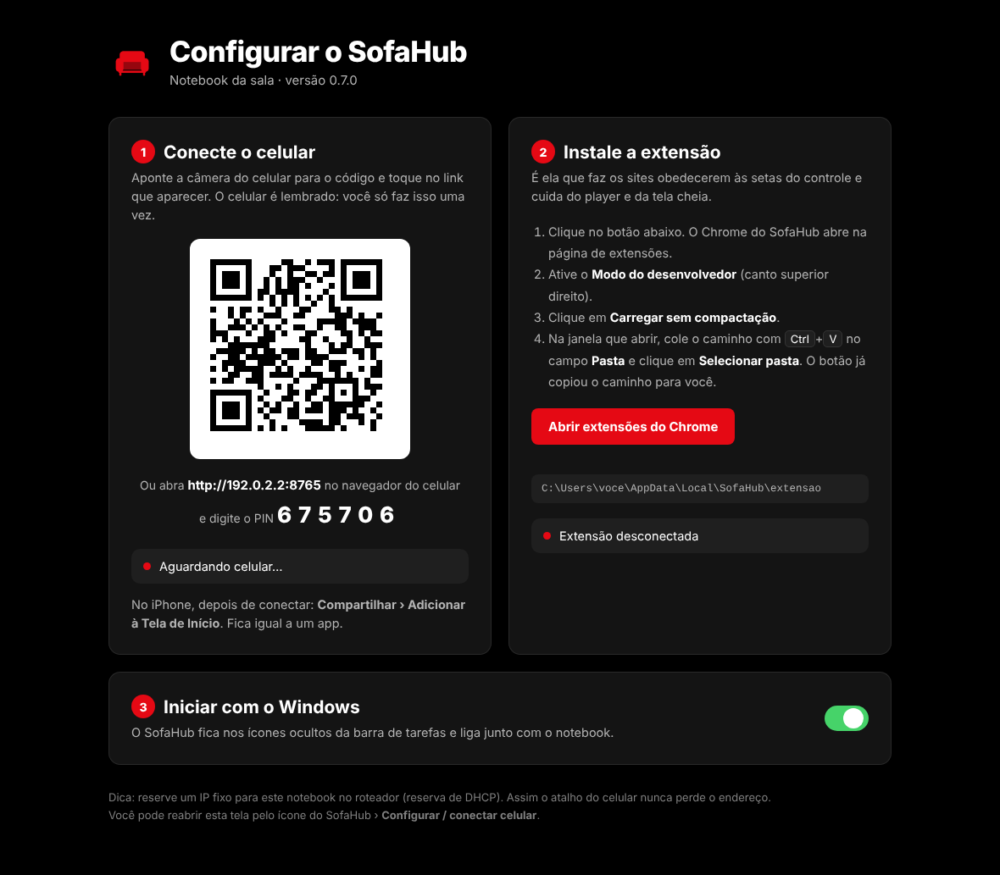

<p align="center"></p>

<h1 align="center">SofaHub</h1>

<p align="center">O computador ligado na TV vira uma <b>smart TV</b>, e o celular vira o <b>controle remoto</b>.<br>
Atalhos para os seus sites, setas e OK como numa TV, play/pausa, próximo episódio, busca, mouse e teclado.</p>

<p align="center"></p>

---

## Instalar (Windows 10/11)

1. Baixe o **`SofaHub-Setup.exe`** em [**Releases**](../../releases/latest) e abra.
   Não precisa ser administrador.
2. No fim, a **tela de configuração** abre sozinha:
   - **Celular:** aponte a câmera para o QR code e toque no link. O celular fica pareado para sempre.
     No iPhone: **Compartilhar › Adicionar à Tela de Início**.
   - **Extensão do Chrome:** clique em *Abrir extensões do Chrome*, ative o **Modo do desenvolvedor**,
     clique em **Carregar sem compactação** e cole a pasta (o botão já copia o caminho).
3. Se o Windows perguntar sobre o **Firewall**, permita em **rede privada**.

Pronto. O SofaHub fica nos ícones ocultos da barra de tarefas e liga junto com o Windows.
Para voltar à tela de configuração, clique duas vezes no ícone.

<p align="center"></p>

> **Dica:** reserve um IP fixo para o computador no roteador (reserva de DHCP). Assim o atalho do celular
> nunca perde o endereço.

Requisitos: Windows 10 ou 11, Google Chrome (ou Edge) e celular na mesma rede Wi-Fi.

## Como usar

| Botão | Navegando no site | Com o vídeo em tela cheia |
|---|---|---|
| ▲ ▼ ◀ ▶ | Move a seleção | ◀ ▶ = −10 s / +10 s |
| OK | Abre o item selecionado | Play / pausa |
| Voltar | Página anterior | Sai da tela cheia |
| ⏮ ⏭ | Episódio anterior / próximo | Idem |
| Tela cheia | Liga/desliga a tela cheia do player | Idem |
| Mouse | Touchpad + teclado, Caps Lock, Alt+Tab, Esc, Win, Gerenciador de Tarefas | Idem |

## Personalizar os atalhos

Já vem com **ETV**, **YouTube**, **Netflix** e **Prime Video**. No ETV, o servidor Byse é escolhido sozinho ao abrir um episódio.

Os atalhos da tela inicial ficam em `%LOCALAPPDATA%\SofaHub\presets.json`
(ícone do SofaHub › *Abrir pasta do SofaHub*). Exemplo:

```json
{
  "id": "youtube",
  "nome": "YouTube",
  "sigla": "YT",
  "cor": "#ff0000",
  "url": "https://www.youtube.com/",
  "busca": "https://www.youtube.com/results?search_query={q}",
  "icone": "icones/youtube.png",
  "tags": ["Vídeos", "Música"]
}
```

- `busca`: endereço de busca com `{q}` no lugar do texto. Ou use `busca_pagina` (página com um campo
  de busca): a extensão digita o texto sozinha.
- `icone` (opcional): sem ele, o SofaHub baixa sozinho o ícone do próprio site na primeira vez. Para usar outro, coloque a imagem `.png`/`.jpg` na pasta `icones` e aponte para ela.
- Para ajustar a navegação ou o player de um site específico, veja `SITES` em `extensao/content.js`.

## Segurança

O SofaHub controla teclado e mouse do PC, então ele é fechado por padrão:

- **Só a rede de casa:** responde apenas a aparelhos da rede local (e Tailscale). Acessos da internet
  são recusados, mesmo se a porta for aberta no roteador.
- **Pareamento por PIN de 6 dígitos**, que muda a cada uso. Depois de 5 erros o PIN é trocado e o
  pareamento fica bloqueado por um tempo que dobra a cada vez. O Windows avisa se alguém tentar adivinhar.
- **Senhas dos celulares guardadas só como hash** (SHA-256). Para revogar: ícone › *Esquecer celulares*.
- **Extensão isolada:** só a extensão do próprio PC fala com o canal dela. Sites abertos no navegador
  não conseguem mandar comandos nem ler o PIN da tela de configuração.
- **Comandos filtrados:** lista fixa de ações, valores limitados e só endereços `http(s)`.
- **Logs sem segredos:** nenhum token ou PIN vai para o arquivo de log.
- **Verificações "você é humano"** de sites nunca são clicadas automaticamente: o SofaHub avisa no
  celular e você resolve pela aba Mouse.

Achou uma falha? Reporte em particular pela aba **Security › Report a vulnerability** do repositório, não em uma *issue* pública.

## Onde ficam os dados

| O quê | Onde |
|---|---|
| Programa | `%LOCALAPPDATA%\Programs\SofaHub` |
| PIN, celulares, atalhos, logs, perfil do navegador | `%LOCALAPPDATA%\SofaHub` |

Desinstalar pelo Windows (*Configurações › Apps*) mantém os dados. Para apagar tudo, remova também a
pasta `%LOCALAPPDATA%\SofaHub`.

## Desenvolvimento

```
sofahub.py      ícone na bandeja (programa principal)
servidor.py     servidor HTTP/WebSocket: app do celular, pareamento, ponte com a extensão
sistema.py      teclado/mouse, energia, iniciar com o Windows
web/            app do celular (PWA) e tela de configuração
extensao/       extensão do Chrome (navegação por setas, player, tela cheia)
presets.json    atalhos padrão
instalador/     script do Inno Setup
```

- Rodar pelo código: `pip install -r requirements.txt` e `iniciar.bat` (ou `depurar.bat` para ver os logs).
  Os dados ficam na própria pasta do projeto e estão no `.gitignore`.
- Gerar o `.exe` e o instalador: `build.bat` (o instalador precisa do
  [Inno Setup](https://jrsoftware.org/isinfo.php): `winget install JRSoftware.InnoSetup`).
- Publicar uma versão: atualize `VERSAO` em `servidor.py` (e `version` em `extensao/manifest.json`), depois
  `git tag v0.7.0 && git push --tags`. O GitHub Actions gera o instalador e publica no Releases.
- **Modo portátil:** com um arquivo `portable.txt` ao lado do `SofaHub.exe`, os dados ficam na mesma pasta.

## Licença

[MIT](LICENSE)
